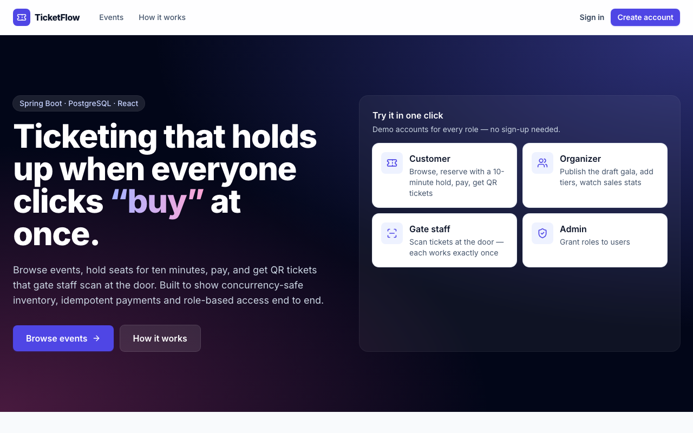
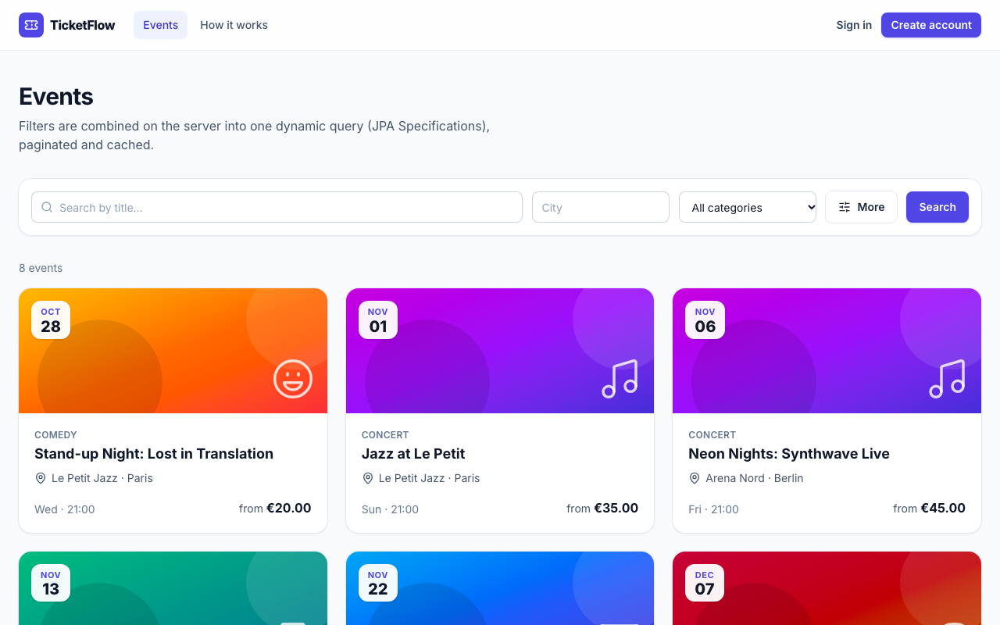
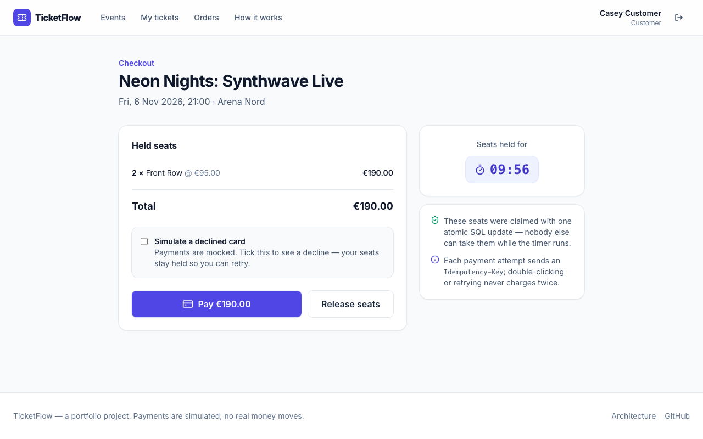
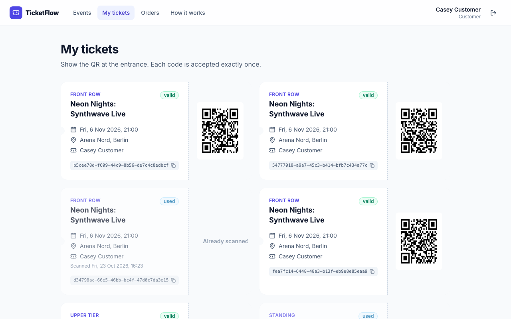
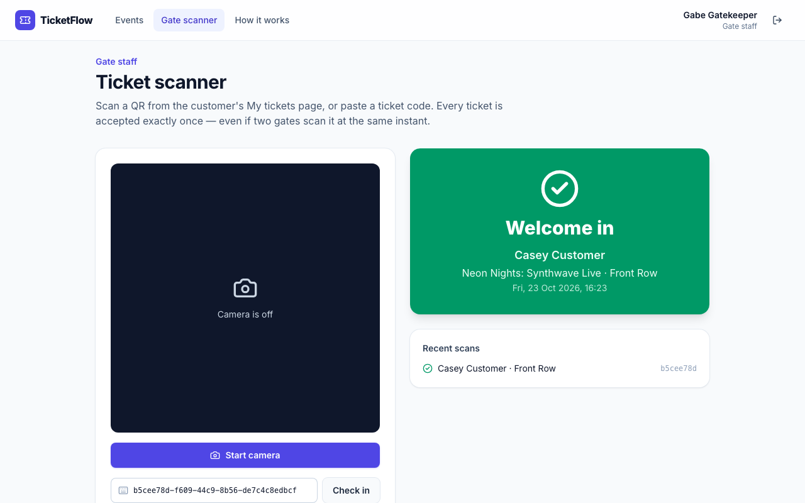
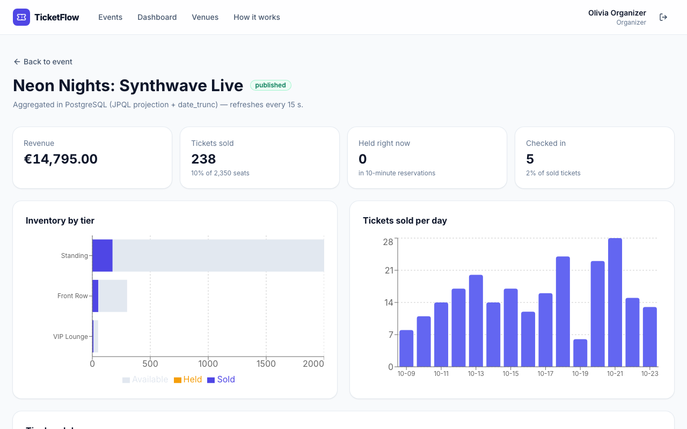

# TicketFlow

A full-stack event ticketing platform: organizers publish events with seat tiers, customers reserve
and pay for tickets, and gate staff scan QR codes at the door.

Built with a deliberate focus on one hard problem:
**never overselling a ticket tier, no matter how many people click "buy" at the same moment.**

**Live demo:** _add your Vercel URL here after deploying (see [DEPLOY.md](DEPLOY.md))_ — one-click demo
accounts for every role, no sign-up. The API runs on a free tier and may take up to a minute to wake.

| | |
|---|---|
|  |  |
|  |  |
|  |  |

## Demo accounts

All use the password `demo1234` (available when the API runs with the `demo` profile).

| Role | Email | Try |
|---|---|---|
| Customer | `customer@demo.ticketflow` | Reserve seats, pay (or simulate a decline), get QR tickets, refund an order |
| Organizer | `organizer@demo.ticketflow` | Publish the draft "Winter Lights Gala", add tiers, view sales charts, cancel an event |
| Gate staff | `gate@demo.ticketflow` | Scan or paste a ticket code — it works exactly once |
| Admin | `admin@demo.ticketflow` | Grant roles to users |

## Tech stack

**Backend:** Java 21 · Spring Boot 3.5 · Spring Security (JWT + rotating refresh tokens) · Spring Data JPA ·
PostgreSQL 16 · Flyway · Caffeine cache · ZXing · Testcontainers

**Frontend:** React 19 · TypeScript · Vite · React Router · TanStack Query · Tailwind CSS · recharts ·
ZXing camera scanning · Vitest · Playwright

**Delivery:** Docker (multi-stage, non-root) · GitHub Actions · Vercel + Render + Neon (free tier)

## Repository layout

```
src/            Spring Boot API
frontend/       React app (see frontend/README.md)
docs/           screenshots
Dockerfile      API image
render.yaml     Render blueprint for the API
DEPLOY.md       step-by-step free-tier deployment
```

## Features

- **Auth** — registration, login, JWT access tokens, refresh tokens with rotation and revocation, role-based access (`CUSTOMER`, `ORGANIZER`, `GATE_STAFF`, `ADMIN`)
- **Catalog** — venues, events, ticket tiers; draft → publish workflow with validation
- **Search** — public event listing with dynamic filters (city, category, date range, price, free text), pagination, sorting and caching
- **Reservations** — 10-minute inventory holds that expire automatically, safe under concurrent load
- **Checkout** — orders, mock payment gateway, idempotent payment, ticket issuance with QR codes
- **Check-in** — one-time ticket scanning at the gate
- **Refunds** — order cancellation and full event cancellation, with an audit trail
- **Reporting** — per-event sales stats and attendee CSV export

## Getting started

**Prerequisites:** Java 21, Node 22, Docker.

```bash
git clone https://github.com/Alex0ar/Event-and-ticketing-system.git
cd Event-and-ticketing-system
cp .env.example .env          # adjust if you like; defaults work for local dev
docker compose up -d          # starts PostgreSQL
SPRING_PROFILES_ACTIVE=dev,demo ./mvnw spring-boot:run   # API on :8080, with demo data
```

In a second terminal:

```bash
cd frontend
cp .env.example .env.local    # VITE_API_URL=http://localhost:8080
npm install
npm run dev                   # http://localhost:5173
```

Flyway creates the schema automatically on first start. Drop `demo` from the profiles if you don't want
the seeded accounts and events.

- API: `http://localhost:8080/api/v1`
- Swagger UI: `http://localhost:8080/swagger-ui.html`
- Health: `http://localhost:8080/actuator/health`

## Running tests

```bash
./mvnw test                       # backend — real PostgreSQL via Testcontainers (Docker must be running)
cd frontend && npm test           # frontend unit/component tests
cd frontend && npm run e2e        # Playwright golden path — needs the full stack running with `demo`
```

CI (GitHub Actions) runs the backend tests, the frontend lint/typecheck/tests/build, and builds the
Docker image on every push and pull request.

> **macOS note:** if Testcontainers can't find Docker, point it at Docker Desktop's engine socket by
> creating `~/.testcontainers.properties`:
> ```
> docker.host=unix:///Users/<you>/Library/Containers/com.docker.docker/Data/docker.raw.sock
> ```

## API overview

| Area | Base path |
|---|---|
| Auth | `/api/v1/auth` |
| Users | `/api/v1/users` |
| Public catalog | `/api/v1/events` |
| Organizer events | `/api/v1/organizer/events` |
| Venues | `/api/v1/venues` |
| Reservations | `/api/v1/reservations` (incl. `GET /current`) |
| Orders & payment | `/api/v1/orders` |
| Tickets | `/api/v1/tickets` |
| Check-in | `/api/v1/checkin` |
| Organizer stats | `/api/v1/organizer/events/{id}/stats` |

Full request/response details are in Swagger UI.

## How overselling is prevented

The core problem: two customers reserving the last seat at the same instant.

A naive `read → check availability → update` sequence has a race — both requests can read the same
state before either writes, and both succeed. The fix used here is an **atomic conditional update**:

```sql
UPDATE ticket_tiers
   SET reserved_quantity = reserved_quantity + :qty
 WHERE id = :id
   AND (total_quantity - reserved_quantity - sold_quantity) >= :qty
```

The check and the increment happen in a single indivisible statement, so there is no gap to race
through. The number of rows updated tells you the outcome: `1` means the hold succeeded, `0` means
there wasn't enough left.

This was chosen over the alternatives because it is correct by construction — there is no
read-then-write window at all:

- **Pessimistic locking** (`SELECT ... FOR UPDATE`) is also correct, but serializes every request for
  a tier and holds locks for the duration of the transaction.
- **Optimistic locking** (`@Version`) alone requires retry logic and wastes work under high contention.

Two further layers back it up:

1. `@Version` on the tier, protecting any entity-based update path.
2. A database `CHECK (reserved_quantity + sold_quantity <= total_quantity)` constraint, which makes an
   oversold row physically impossible to store.

Reservations that are never paid for are released by a scheduled job, returning the held quantity to
the pool.

## Design notes

- **Layering** — `Controller → Service → Repository`. Controllers handle HTTP only; entities are never
  returned from controllers, always mapped to DTOs.
- **Flyway owns the schema.** Hibernate runs with `ddl-auto: validate` and never modifies tables.
- **Money** is `BigDecimal` / SQL `NUMERIC`, never floating point.
- **Caching** — the public event listing is cached (60s TTL, evicted on publish). Availability shown
  there may lag slightly; that is acceptable for browsing. The reservation path always reads fresh
  from the database and never uses the cache.
- **Idempotent payments** — the pay endpoint accepts an `Idempotency-Key` so a retried request never
  charges twice or issues duplicate tickets.

## Configuration

All configuration is externalized; nothing sensitive is committed. See `.env.example` for the
variables in use. Profiles: `dev` (default, local), `test` (Testcontainers), `prod` (all values
required from the environment), `demo` (seeds the demo accounts and events; combine with another
profile, e.g. `prod,demo`).

| Variable | Purpose |
|---|---|
| `DB_URL` / `DB_USER` / `DB_PASSWORD` | Database (prod) |
| `JWT_SECRET` | Token signing key, ≥ 32 chars (required in prod) |
| `APP_CORS_ALLOWED_ORIGINS` | Comma-separated frontend origins allowed to call the API |
| `APP_DEMO_RESET_ON_STARTUP` | With `demo`: wipe and reseed on every boot |
| `PORT` | HTTP port (set by most hosts) |

## Project status

Learning project, built in phases: foundation → auth → catalog → reservations → checkout →
check-in/refunds/reporting → web frontend and live demo.
